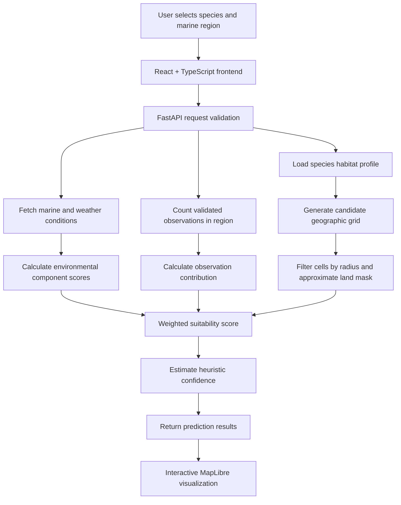
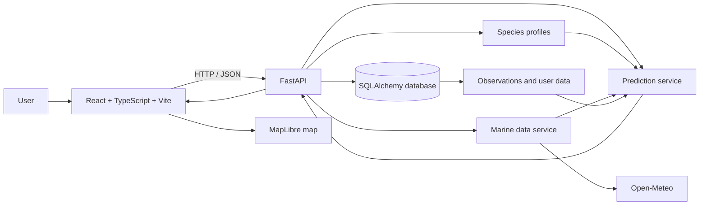

# 🌊 AquaTech

### Find the water. Understand the habitat. Make smarter fishing decisions.

**A marine species discovery and habitat-suitability platform powered by environmental data, species profiles, and community observations.**

[](https://react.dev/)
[](https://www.typescriptlang.org/)
[](https://vite.dev/)
[](https://fastapi.tiangolo.com/)
[](https://www.python.org/)
[](https://maplibre.org/)

[Explore the repository](https://github.com/inferno4670/AquaTech) · [Report a bug](https://github.com/inferno4670/AquaTech/issues) · [Request a feature](https://github.com/inferno4670/AquaTech/issues)

</div>

---

## 📚 Contents

- [What is AquaTech?](#-what-is-aquatech)
- [Highlights](#-highlights)
- [How it works](#-how-it-works)
- [Prediction model](#-prediction-model)
- [Architecture](#-architecture)
- [Tech stack](#-tech-stack)
- [Repository layout](#-repository-layout)
- [Run locally](#-run-locally)
- [Configuration](#-configuration)
- [API overview](#-api-overview)
- [Understanding the results](#-understanding-the-results)
- [Limitations and scientific honesty](#-limitations-and-scientific-honesty)
- [Deployment](#-deployment)
- [Roadmap](#-roadmap)
- [Contributing](#-contributing)
- [License](#-license)

## 🌐 What is AquaTech?

AquaTech is a full-stack marine decision-support application that helps users explore fish species and identify **potentially suitable marine areas** using species-specific habitat preferences, environmental conditions, seasonal behavior, and available community sightings.

The frontend presents results on an interactive map. The backend evaluates geographic grid cells with a weighted, rule-based suitability model and returns scores that can help users compare locations.

> **Important:** AquaTech is a prototype decision-support tool, not a guaranteed fish locator. Suitability scores are heuristic estimates, not measured fish abundance or calibrated probabilities. Always follow local fishing laws, seasonal restrictions, protected-area rules, and species conservation guidance.

## ✨ Highlights

- 🗺️ **Interactive map:** Explore marine areas through a MapLibre-powered map interface.
- 🐟 **Species-aware scoring:** Evaluate locations against species-specific habitat preferences.
- 🌡️ **Environmental context:** Use marine and weather information supplied through Open-Meteo integrations.
- 📍 **Community observations:** Incorporate validated sightings available in the database.
- 📊 **Suitability zones:** Classify scores into very high, high, moderate, and low categories.
- 🎯 **Confidence estimate:** Display a heuristic confidence indicator alongside the suitability result.
- 🛡️ **Conservation awareness:** Surface species protection and legal-status information where available.
- 🔐 **Account support:** Backend includes authentication-related functionality and user-linked data.
- 🧩 **API-first design:** React frontend communicates with a FastAPI backend.
- 🗃️ **Persistent data layer:** SQLAlchemy models support application data and observations.

## 🧭 How it works

The current pipeline is a practical, explainable baseline rather than a trained machine-learning model.



### The request lifecycle

1. **Choose a species and area.** The frontend sends the selected species, region, and search parameters to the API.
2. **Validate the request.** FastAPI checks the request and resolves the species and region information.
3. **Gather context.** The backend uses species habitat data, marine/weather conditions, and available validated observations.
4. **Build candidate cells.** A geographic grid is generated for the requested search area. Cells outside the search radius or identified as land by the current approximate mask are filtered out.
5. **Score each candidate.** Environmental and species-specific component scores are combined using fixed weights.
6. **Return and visualize.** The API returns scored locations and related metadata; the frontend maps them into suitability categories.

## 📈 Prediction model

### Weighted multi-criteria suitability

AquaTech currently uses a **rule-based weighted scoring model**. It does **not** currently train a Random Forest, Decision Tree, neural network, or other supervised learning model for the main suitability prediction.

Each component is normalized to a value from `0.0` to `1.0`. The weighted components are combined into an overall suitability score:

\[
S = 0.30T + 0.22D + 0.16H + 0.14C + 0.10M + 0.08W
\]

| Component | Weight | What it represents |
|---|---:|---|
| Temperature (`T`) | 30% | How closely water temperature matches the species profile |
| Depth (`D`) | 22% | How closely estimated depth matches preferred habitat |
| Historical similarity (`H`) | 16% | Similarity to available historical or observation-related context |
| Current (`C`) | 14% | Suitability of current-related conditions |
| Seasonality (`M`) | 10% | Seasonal suitability for the selected species |
| Waves (`W`) | 8% | Suitability of wave conditions |

The weights total **100%**. A higher score means the modeled conditions match more of the rules encoded for that species. It does not prove that fish are present.

### Score categories

The frontend classifies suitability using these thresholds:

| Score | Category |
|---:|---|
| `0.81–1.00` | Very high |
| `0.61–0.80` | High |
| `0.31–0.60` | Moderate |
| `0.00–0.30` | Low |

### Confidence is a heuristic

The backend calculates a separate confidence-like indicator using factors such as data freshness, the presence of observations, and how far the suitability score is from the middle of the scale. The current implementation uses a fixed freshness factor and a heuristic formula.

**Do not interpret this value as an 80% statistical probability of catching a fish.** It has not been calibrated against a sufficiently large, independent set of real-world outcomes.

<details>
<summary><strong>🔬 Current implementation details</strong></summary>

- Candidate cells are generated at approximately 10 km spacing.
- The current depth value is a rough geographic proxy, not a measurement from a bathymetric dataset.
- The current land filter is a coarse regional heuristic, not a high-resolution coastline polygon.
- The current marine-data implementation can reuse a representative regional/centroid sample across grid cells. Therefore, conditions may not vary realistically from cell to cell.
- The observation-density contribution is based on the count of validated observations in the selected region, with a simple cap. It is not a statistically validated catch-rate estimator.
- Confidence uses fixed and heuristic factors rather than a trained uncertainty model.

These are known prototype simplifications and should be considered when interpreting results.

</details>

## 🏗️ Architecture



The frontend and backend are separate applications. The frontend calls the backend over HTTP; the backend owns request validation, species data access, environmental-data integration, prediction logic, and database operations.

## 🧰 Tech stack

| Layer | Technology | Purpose |
|---|---|---|
| Frontend | React, TypeScript, Vite | Interactive user interface |
| Mapping | MapLibre GL | Geographic visualization |
| API | Python, FastAPI | REST endpoints and validation |
| Data access | SQLAlchemy async | Database models and queries |
| Marine data | Open-Meteo integration | Marine/weather context |
| Authentication | JWT-related backend support | Authenticated user flows |
| Database | SQLite by default / configurable database URL | Local development and persistence |

## 🗂️ Repository layout

```text
AquaTech/
├── frontend/                 # React + TypeScript + Vite application
│   └── src/
│       ├── api.ts            # Backend API client and base URL
│       └── components/
│           └── suitability.ts # Suitability category thresholds
├── backend/                  # FastAPI application
│   └── app/
│       ├── api/               # API routes
│       │   ├── predictions.py # Prediction endpoints
│       │   ├── marine.py      # Marine conditions endpoint
│       │   └── species.py     # Species and region endpoints
│       ├── data/
│       │   └── species_db.py  # Species profiles and habitat rules
│       └── services/
│           ├── prediction.py  # Grid generation and scoring logic
│           └── marine.py      # Marine/weather data integration
└── DATA_SPECIES/
    └── SPECIES_DATASET.md     # Species and habitat reference material
```

> File names can change as the project evolves. Use the current repository tree as the source of truth if a path above no longer exists.

## 🚀 Run locally

### Prerequisites

- Git
- Node.js and npm
- Python 3.10+ recommended
- A terminal and code editor

### 1. Clone the repository

```bash
git clone https://github.com/inferno4670/AquaTech.git
cd AquaTech
```

### 2. Start the backend

```bash
cd backend
python -m venv .venv
```

Activate the virtual environment:

**Windows PowerShell**
```powershell
.venv\Scripts\Activate.ps1
```

**macOS / Linux**
```bash
source .venv/bin/activate
```

Install the backend dependencies listed by the project. If your checkout does not contain a dependency manifest yet, create one before deployment and include the imports used by the backend, such as FastAPI, Uvicorn, SQLAlchemy, and the required database driver.

Then start the API from the `backend/` directory:

```bash
uvicorn app.main:app --reload --host 127.0.0.1 --port 8000
```

Useful local endpoints, if enabled by the application:

- API docs: `http://127.0.0.1:8000/docs`
- OpenAPI schema: `http://127.0.0.1:8000/openapi.json`
- Health endpoint: check the backend routes for the exact configured path.

### 3. Start the frontend

Open a second terminal:

```bash
cd frontend
npm install
```

Create a `.env.local` file in `frontend/`:

```dotenv
VITE_API_URL=http://127.0.0.1:8000
```

Then start Vite:

```bash
npm run dev
```

Open the local URL printed by Vite, commonly `http://localhost:5173`.

<details>
<summary><strong>🧯 Troubleshooting</strong></summary>

**The frontend cannot reach the API**
- Confirm the backend is running and reachable.
- Check `VITE_API_URL`; it should contain the backend origin, without an endpoint path unless the API client expects one.
- Restart Vite after changing environment variables.

**CORS errors**
- Configure backend CORS to allow the exact local frontend origin and your deployed frontend origin.
- Do not use wildcard origins with credentialed requests in production.

**Database or driver errors**
- Verify the database URL and install the matching database driver.
- For hosted production deployments, use a persistent PostgreSQL database rather than relying on an ephemeral local SQLite file.

**Missing Python packages**
- Check for a backend dependency manifest. If one is absent, create and maintain `requirements.txt` or `pyproject.toml` before attempting a reproducible deployment.

</details>

## ⚙️ Configuration

### Frontend environment variables

| Variable | Required | Description |
|---|---|---|
| `VITE_API_URL` | Yes for deployment | Public base URL of the FastAPI backend |

Example:

```dotenv
VITE_API_URL=https://your-api.example.com
```

Vite exposes variables prefixed with `VITE_` to browser-side code. **Never put private API keys, database credentials, or signing secrets in frontend environment variables.**

### Backend configuration

The backend may read database and security settings from environment variables. Check the actual configuration module in your checkout and set the variable names it expects.

For production:
- Use a persistent PostgreSQL database.
- Set a strong, unique secret key through the hosting provider's secret manager.
- Restrict CORS to trusted frontend origins.
- Keep credentials out of source control.
- Use HTTPS for deployed frontend and API.
- Add request limits, logging, and appropriate error handling before exposing the service publicly.

## 🔌 API overview

The backend is organized around FastAPI route modules. Confirm exact request and response schemas in `/docs` for the version you are running.

| Area | Route/module | Purpose |
|---|---|---|
| Predictions | `POST /predict` | Request a suitability prediction |
| Predictions | `POST /predictions` | Prediction-related operation |
| Prediction lookup | Run-ID lookup | Current implementation may return `501 Not Implemented` |
| Marine conditions | Marine API routes | Retrieve environmental context |
| Species | Species API routes | List species and retrieve species profiles/regions |

A typical prediction flow is:

```text
Frontend selection
    → POST prediction request
    → validate species and region
    → obtain marine conditions and observation context
    → score candidate grid cells
    → return prediction payload
    → render locations and suitability on the map
```

Example request shape below is **illustrative only**. Use the exact schema displayed by your running `/docs` page:

```json
{
  "species_id": "example-species",
  "region_id": "example-region"
}
```

## 🧠 Understanding the results

- **Suitability** answers: “How well do the modeled conditions match this species profile?”
- **Confidence indicator** answers: “How strong does the current heuristic consider the supporting context?”
- **Sightings** provide community-observation context, subject to the quality, validation, and recency of the data.
- **Conservation information** is informational. Verify current legal requirements with the relevant local authority before fishing.

A high score should be read as **a promising modeled area**, not a guarantee. Marine ecosystems are dynamic, and a map cannot repeal biology.

## ⚠️ Limitations and scientific honesty

The current model is best treated as an explainable prototype. Important limitations include:

1. **Approximate bathymetry:** Depth is not currently derived from a dedicated, high-resolution bathymetric source.
2. **Coarse coastline filtering:** A heuristic land mask can misclassify coastal or near-shore cells.
3. **Limited spatial variation:** Reusing a representative marine sample across multiple cells can hide local environmental differences.
4. **Heuristic confidence:** Confidence is not a calibrated probability and should not be presented as one.
5. **Observation bias:** Community sightings can be sparse, unevenly distributed, unverified, or affected by reporting patterns.
6. **No demonstrated predictive validation:** Suitability scores should not be described as proven catch predictions without independent evaluation.

### Recommended validation plan

- Compare model rankings with timestamped, geolocated observations.
- Keep training/tuning observations separate from held-out evaluation data.
- Evaluate ranking quality and classification metrics where labels are available.
- Measure calibration before interpreting confidence probabilistically.
- Record environmental-data timestamps and missing-data behavior.
- Test across seasons, regions, and species instead of relying on one coastal area.

## ☁️ Deployment

A simple split deployment can use a static frontend host, an API host, and a managed database.

| Component | Example option | Important setting |
|---|---|---|
| Frontend | Vercel | Root directory `frontend`; build `npm run build`; output `dist` |
| Backend | Render or another Python host | Root directory `backend`; start with Uvicorn and the host-provided port |
| Database | Supabase PostgreSQL or another managed PostgreSQL provider | Set the backend's database URL and install the correct driver |

Example backend start command:

```bash
uvicorn app.main:app --host 0.0.0.0 --port $PORT
```

Set `VITE_API_URL` to the deployed API origin in the frontend host, and allow that frontend origin in backend CORS settings. Confirm the backend's required dependency manifest exists before deploying; the hosting platform cannot reliably infer every Python dependency from vibes alone.

**Before going live:** test API docs, prediction requests, authentication, database persistence, CORS, error responses, and the frontend map against the deployed API. Hosting free tiers and their limits can change, so verify current provider terms before relying on them.

## 🛣️ Roadmap

- [ ] Replace approximate depth with a real bathymetry data source.
- [ ] Use a reliable coastline and marine-boundary dataset.
- [ ] Query environmental conditions per cell or through spatially appropriate interpolation.
- [ ] Add observation timestamps, provenance, and stronger verification.
- [ ] Validate suitability rankings against held-out real-world observations.
- [ ] Calibrate confidence estimates or rename them to avoid implying probability.
- [ ] Add automated backend and frontend tests.
- [ ] Add reproducible dependency manifests and deployment checks.
- [ ] Improve API rate limiting, logging, monitoring, and production security.
- [ ] Document endpoint schemas and example responses.

## 🤝 Contributing

Contributions that improve data quality, model explainability, usability, testing, or conservation awareness are welcome.

1. Fork the repository.
2. Create a focused branch: `git checkout -b feat/your-improvement`
3. Make and test your changes.
4. Commit with a clear message: `git commit -m "Add your improvement"`
5. Push your branch and open a pull request.

For bug reports, include steps to reproduce, expected behavior, actual behavior, and relevant logs. Do not include passwords, tokens, or other secrets.

## 📄 License

Check the repository for a `LICENSE` file before reusing or redistributing this project. If no license is present, do not assume the code is open for unrestricted reuse.

---

<div align="center">

**Built to explore marine habitats more thoughtfully. 🌊**

[Back to top ↑](#-aquatech)

</div>
